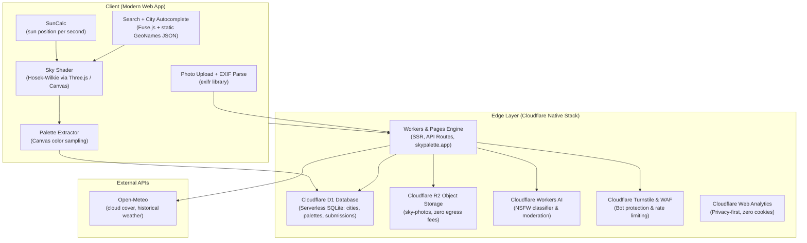
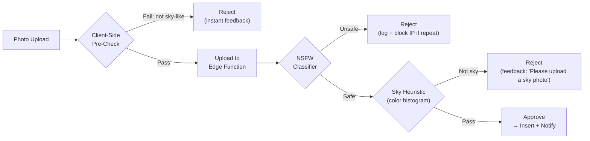
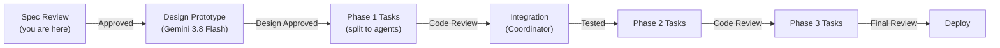

# Sky Palette — Product & Technical Specification

> **Status:** Draft — Awaiting Review  
> **Last updated:** 2026-11-14  
> **Stack:** Next.js / Cloudflare Workers · Cloudflare D1 (SQLite) · Cloudflare R2 · Cloudflare Turnstile · Open-Meteo · SunCalc

---

## 1. Vision

Sky Palette is a free, community-driven web gallery that turns the sky above any city into a shareable color palette. It blends **physics-based sky simulation** (Preetham / Hosek-Wilkie model + real weather data) with **crowd-sourced sky photographs**, producing five-swatch palette cards for every moment of the day.

The experience is minimal, fast, and premium — closer to Instagram's clean visual language than a weather dashboard.

---

## 2. Core Concepts

| Concept | Description |
|---|---|
| **Sky Palette** | Five color swatches — *Zenith, Mid-Sky, Horizon, Sun Glow, Cloud Tint* — with hex codes, sampled from a physics model or a user photograph. |
| **Generated Palette** | Computed from Open-Meteo cloud-cover data (low / mid / high layers) + SunCalc sun position + Hosek-Wilkie sky shader. No photo needed. |
| **Community Palette** | Extracted from a user-submitted sky photograph at the same location + time, color-sampled into the same five-swatch format. |
| **Palette Card** | The shareable unit: location · date · time · 5 swatches · hex codes · optional photo thumbnail. Downloadable as PNG/SVG, copyable link. |

---

## 3. User Flows

### 3.1 Home → Bucharest HQ Live Sky & Jog-Dial Scrubber

```
┌────────────────────────────────────────────────────────┐
│                                                        │
│               [Clean Sky Gradient - No Logo]           │
│                                                        │
│                    ● Bucharest HQ · 15:17 EET          │
│          ┌───────────────────────────────────┐         │
│          │ Search city, ZIP, or postal code  │  (52px) │
│          └───────────────────────────────────┘         │
│    Suggested: Bucharest · Tokyo · Paris · Buenos Aires │
│                                                        │
│                         11:15                          │
│               |||||||||||||❚||||•|||                   │
│                                                        │
│     ┌─────────────────────────────────┐   ┌───┐        │
│     │   Home   ·   Gallery   · Submit │   │ ↗ │ (52px) │
│     └─────────────────────────────────┘   └───┘        │
│                                                        │
└────────────────────────────────────────────────────────┘
```

- **Clean Unobstructed Sky:** The top of the Home screen is completely clear with no branding or logos, showcasing the authentic physical sky gradient.
- **Bucharest HQ Time Anchor:** A quiet, single-line indicator (`● Bucharest HQ · 15:17 EET`) floats directly above the search bar, serving as the sole, non-redundant location anchor.
- **Borderless Black Search Pill & Refined Search Results:** A borderless pure black floating pill (`h-[52px] sm:h-[56px] bg-black text-white rounded-full shadow-2xl`) with concise placeholder (`placeholder="Search city or postal code"`). Search results feature:
  - **Single-Result Matching Pill:** When search yields exactly 1 result, the dropdown container dynamically matches the search bar geometry: fully rounded borders (`rounded-full`), identical height (`h-[52px]` mobile / `h-[56px]` desktop), identical width, and unified padding (`px-5 sm:px-6`).
  - **Multi-Result Card:** When 2+ results match, expands into an elegant rounded card (`rounded-3xl` on Home, `rounded-2xl` in Modal) with dividers.
  - **City-First Information Hierarchy:** The primary bold title ALWAYS displays the **City** being searched for (e.g. `Bucharest`, `Tokyo`, `Paris`, or `Paris (1er Arr.)`), never a raw ZIP code as the title. Secondary metadata displays country, coordinates, and postal code (e.g. `France · Postal Code 75001`).
  - **Circular Leading Badges:** Numeric postal code matches feature a circular emerald badge (`w-7 h-7 rounded-full bg-emerald-500/20 text-emerald-400`); city matches feature a circular badge with `MapPin` icon.
  - **Selection Affordance:** Right-aligned `Select →` cue with micro-animated arrow on hover.
- **Unified Heights (Search, Bottom Dock, Share Button):**
  - Search Bar: `h-[52px] sm:h-[56px]`
  - Bottom Navigation Dock: `h-[52px] sm:h-[56px] p-1.5`
  - Circular Share Button: `w-[52px] h-[52px] sm:w-[56px] sm:h-[56px]` (exact 1:1 match to search bar height)
- **Jog-Dial Step Scrubber (iOS Momentum & Bounce):**
  - Positioned with generous vertical clearance (`mb-36 sm:mb-36 md:mb-40`, establishing a guaranteed **72px – 76px** clear vertical gap above the bottom navigation dock on all screen sizes) to eliminate touch ambiguity and accidental dock taps during dragging.
  - Discrete 15-minute stepping (`00:00`, `00:15`, ..., `11:15`, ..., `15:00`, `15:17` live).
  - **Circled Pill Geometry:** Unmistakably rounded capsules with deep semicircular caps (`border-radius: 9999px`). Normal pills measure `4.5px × 15px`; the active center needle expands to `6.5px × 24px` with prominent `3.25px` radius caps.
  - **Smooth Atmospheric Contrast Adaptation:** Perceptual luminance engine ($Y = 0.299R + 0.587G + 0.114B$) calculates the background sky brightness directly behind the scrubber. A continuous $C^1$ Hermite smoothstep smoothly interpolates the time text and active pill colors between solid **black** (`rgb(0, 0, 0)`) against light daytime skies and crisp **white** (`rgb(255, 255, 255)`) against dark night skies, transitioning seamlessly without abrupt switching.
  - Surrounding ticks: semi-translucent white capsules fading smoothly at left/right edges via CSS linear gradient mask; zero horizontal track lines or borders.
  - Bucharest HQ Live Time Indicator: Features a crisp emerald green dot (`#22c55e`, 4.5px diameter) centered directly beneath its bottom tip.
  - Hard Stop at Live Time: Scrubber stops at Bucharest live time; future steps to the right are disabled/blocked with iOS elastic rubber-band resistance.
  - Fluid iOS Momentum & Bounce: Coasting with $0.93$ friction decay; rubber-band spring returns at boundaries via `requestAnimationFrame`.
  - Dynamic Time Sizing: Time text expands while scrolling (`text-lg sm:text-xl font-bold`), contracting when resting/snapped (`text-xs sm:text-sm font-semibold`). Zero sub-captions.

### 3.2 Location Selector & Search Location Modal (Light Variant)

```
┌────────────────────────────────────────────────────────┐
│  Search Location                                   [×] │
│  Switch gallery to another city or postal code         │
├────────────────────────────────────────────────────────┤
│  ┌──────────────────────────────────────────────────┐  │
│  │ 🔍 Search city or postal code            [WHITE] │  │
│  └──────────────────────────────────────────────────┘  │
│                                                        │
│  POPULAR SKIES                                         │
│  ┌────────────────────────┐  ┌───────────────────────┐ │
│  │ Bucharest (HQ)   44.4°N│  │ Tokyo, Japan    35.6°N│ │
│  ├────────────────────────┤  ├───────────────────────┤ │
│  │ Reykjavik        64.1°N│  │ Paris, France   48.8°N│ │
│  └────────────────────────┘  └───────────────────────┘ │
└────────────────────────────────────────────────────────┘
```

- **Light Variant Presentation:** The modal card utilizes an airy, clean light theme (`bg-white text-neutral-900 rounded-3xl shadow-2xl border border-black/10`).
- **White Search Bar with Black Content:** Clean white floating pill (`bg-white text-black rounded-full h-[52px] px-5 border border-black/15 focus-within:border-black shadow-xs`) with neutral search icon, black text, and subtle neutral placeholder (`placeholder:text-neutral-400 text-xs sm:text-sm`).
- **Real-Time Autocomplete & Enhanced Results:** Supports instant filtering across global cities, Romanian postal codes (e.g. `010011`), and international ZIP codes (e.g. `75001`), badged with circular emerald `ZIP` tokens (`w-7 h-7 rounded-full bg-emerald-50 text-emerald-700 border border-emerald-200`) and clean 2-line location hierarchy.
- **Popular Skies:** Quick pick grid featuring Bucharest HQ, Tokyo, Reykjavik, and Paris in light neutral capsules (`bg-neutral-100 hover:bg-neutral-200 text-neutral-800`).
- **Default HQ:** The application is anchored in Bucharest, Romania (`44.4268° N, 26.1025° E`). Clicking Gallery for the first time without an active search opens this modal with Bucharest pre-selected.

### 3.3 City Gallery (Zero-Scroll Fullscreen Mosaic)

```
┌────────────────────────────────────────────────────────┐
│ [● Bucharest · HQ · 44.4°N ▾]   [15-Day Sunset Mosaic] │
├────────────────────────────────────────────────────────┤
│ ┌──────┬──────┬──────┬──────┬──────┐                  │
│ │Nov 14│Nov 13│Nov 12│Nov 11│Nov 10│                  │
│ │16:51 │16:52 │16:53 │16:54 │16:56 │                  │
│ ├──────┼──────┼──────┼──────┼──────┤                  │
│ │Nov 9 │Nov 8 │Nov 7 │Nov 6 │Nov 5 │                  │
│ ├──────┼──────┼──────┼──────┼──────┤                  │
│ │Nov 4 │Nov 3 │Nov 2 │Nov 1 │Oct 31│                  │
│ └──────┴──────┴──────┴──────┴──────┘                  │
│                                                        │
│        ( [Home]  [Gallery]  [Submit] )  ( ⚑ Share )    │
└────────────────────────────────────────────────────────┘
```

- **Fullscreen 0-Gap Grid:** 15 full-bleed day cards (5 columns × 3 rows) fitting 100vh on desktop without any vertical scrolling.
- **5-Stripe Color Bands:** Each day card displays the 5-swatch palette bands extracted from that day's sunset golden hour moment.
- **Day Detail Access:** Clicking any day tile opens Day Detail for that specific day.

### 3.4 Day Detail (Unboxed & Reference Photo Overlay)

```
┌────────────────────────────────────────────────────────┐
│ [← Gallery]  Nov 12 · Bucharest   [Ref Photo Active]   │
├────────────────────────────────────────────────────────┤
│ ┌────────────────────────────────────────────────────┐ │
│ │ 16:51 Sunset · Sun: +0.8° · Azimuth: 236°          │ │
│ │ [Live Sky Simulation Viewport / Preetham Model]    │ │
│ └────────────────────────────────────────────────────┘ │
│                                                        │
│  ■ Zenith   ■ Mid-Sky  ■ Horizon  ■ Sun Glow  ■ Cloud  │
│  #121734    #2A1F42    #943440    #E06038     #FC9858  │
│                                                        │
│  [▶] 16:51  [12:00] [Golden] [Sunset]                  │
│       │  │  │  ┃  │  │  │   (Jog-Dial Ruler Scrubber)  │
│                                                        │
│  Photos from this day:                                 │
│  [ Herastrau ] [ Calea Victoriei ] [ Dambovita ]       │
└────────────────────────────────────────────────────────┘
```

- **Pure Minimalist Canvas:** Unboxed pure white background (`#ffffff`), no container cards.
- **Overflow-Proof Responsive Top Bar:** Back navigation `← Gallery` alongside flexible title and time/phase subtitle, maintaining >150px clearance on narrow viewports (360px - 393px) with zero collision or wrapping.
- **Jog-Dial Ruler Scrubber:** Unified with the Home view jog-dial scrubber: full rounded capsule ticks (`border-radius: 9999px`, 4.5px/15px inactive, 6.5px/24px active black center tick), centered time display directly above center needle, soft edge fade masks, play timelapse animation, and quick jump buttons (`12:00`, `Golden`, `Sunset`).
- **Reference Image Split:** Clicking a community photograph triggers a slide-out overlay displaying the real captured image alongside the simulated sky for direct color fidelity verification.

### 3.5 Bottom Dock & Social Telemetry Sharing

- **Minimalist 3-Pill Dock:** Black rounded pill housing `Home`, `Gallery`, and `Submit` (`Day Detail` removed from primary nav).
- **Dedicated Circular Share Button:** Positioned on the right of the dock, triggering an interactive **Strava-style atmospheric telemetry card modal** (Dark, Studio, and Horizon styles) with one-click PNG export and link sharing.

### 3.6 Contribution Flow (Privacy-First Modal)

```
┌────────────────────────────────────────────────────────┐
│  Share a photo of your sky                         [×] │
├────────────────────────────────────────────────────────┤
│  ┌──────────────────────────────────────────────────┐  │
│  │ ⬆ Drop your sky photo here                       │  │
│  │   JPG, PNG, HEIC up to 25MB · EXIF extracted     │  │
│  └──────────────────────────────────────────────────┘  │
│                                                        │
│  ┌───────────────────────┐  ┌────────────────────────┐ │
│  │ 📍 Bucharest, Romania │  │ 🕒 16:51               │ │
│  └───────────────────────┘  └────────────────────────┘ │
│                                                        │
│  Extracted colors  ●●●●●              Valid sky photo  │
│  ┌────────────┐  ● #121734                      Zenith │
│  │ IMG_5891   │  ● #2A1F42                     Mid-Sky │
│  │ [Preview]  │  ● #943440                     Horizon │
│  │            │  ● #E06038                    Sun Glow │
│  └────────────┘  ● #FC9858                       Cloud │
│                                                        │
│  Handle: sky-bucharest-48b                     [Regen] │
│                                                        │
│  [ Submit for review ↗ ]                               │
│  No account needed. Automated review.                  │
└────────────────────────────────────────────────────────┘
```

1. **User taps Submit** on the bottom nav dock.
2. **Upload a photo** → client-side EXIF extraction for timestamp + GPS.
3. **Same-Line Metadata Form:**
   - Location and Capture Time sit on the exact same horizontal line.
   - Built-in leading icons (`MapPin` inside Location field, `Clock` inside Time field).
   - Zero redundant field labels.
4. **Extracted Colors & Swatch Previews:**
   - Circled color bubbles (`rounded-full`) left of each hex code text (`#121734`, `#2A1F42`, `#943440`, `#E06038`, `#FC9858`).
   - Quick 5-circle palette strip beside the "Extracted colors" section title.
5. **Client-side pre-check:**
   a. Aspect ratio / resolution validation.
   b. Blue-sky heuristic (HSL color distribution — sky photos are dominated by blues, oranges, pinks; reject if mostly skin tones, greens, or indoor colors).
6. **Server-side moderation:**
   a. Cloudflare Worker calls a lightweight NSFW classifier (e.g., Cloudflare Workers AI `@cf/microsoft/resnet-50` or a small ONNX model) — binary safe/unsafe.
   b. A simple color-histogram check confirms "sky-like" content.
7. **Privacy:** Zero accounts, zero tracking, anonymous contributor handle with one-click regeneration.

### 3.7 Project Info, Legal & Telemetry Modal (`#info-modal`)

- **Discreet Universal Entry Points:**
  - `screen-home`: Fixed top-right circular button (`w-9 h-9`, backdrop blurred, `info` icon). Actionable exclusively via this top button (no footer link).
  - `screen-gallery`: Circular icon button placed in the top bar right beside the interval toggle (`15D Mosaic`).
  - `screen-detail`: Circular icon button in the header right beside the reference photo badge.
- **Modal Content Architecture:**
  - **Header:** Project name ("Sky Palette"), current version badge (`v1.2.0`), one-line physical description, and discreet close button.
  - **Quick Action Bar:** Direct link to GitHub repository, "Report a Bug" link with authentic Lucide bug icon opening GitHub issues with a pre-filled template, and an anchor jumping to Release Notes.
  - **Core Technologies Grid:** 6 structured cards explaining Preetham/Hosek-Wilkie scattering, SunCalc astronomical engine, Open-Meteo cloud dynamics, modern vanilla web stack, Cloudflare D1 & R2 zero-cookie storage, and Cloudflare edge analytics.
  - **Usage Monitoring & Cloudflare Telemetry:** Explains the non-invasive, privacy-preserving monitoring architecture (zero cookies, zero fingerprinting, aggregate Core Web Vitals).
  - **Privacy & Cookies Statement:** Highlights 100% cookie-free operation, no accounts, and anonymous public API tokens. Includes inline expandable drawers for the complete Privacy Policy and Terms of Service.
  - **Licenses & Credits:**
    - Web Codebase: MIT License
    - Community Contributed Photos: Dedicated to Public Domain under CC0 1.0 Universal
    - Open-Meteo Weather Data: Creative Commons Attribution 4.0 (CC BY 4.0)
    - Design Methodology: Unslopped with methodology by Damir Sokolovsky (CC BY 4.0)
  - **Release Notes Changelog:** Version history covering v1.2.0 (Jog-dial scrubber, unboxed modals, contrast engine, telemetry), v1.1.0 (Atmospheric cards, PNG export), and v1.0.0 (MVP launch).
  - **Footer:** Bucharest HQ geographic coordinates (`44.4°N, 26.1°E`), license summaries, secondary Report Bug link, and Close button.

> [!IMPORTANT]
> **Privacy commitment:** We collect only the photo, its location, and its timestamp. No PII. No accounts. No tracking. Zero cookies.

---

## 4. Architecture



### 4.1 Data Flow — Generated Palette

1. User selects city + date + time (or drags slider).
2. **Client-side** (zero API calls):
   - SunCalc computes solar azimuth + elevation.
   - Hosek-Wilkie sky shader renders gradient.
   - Canvas samples 5 swatch points → hex codes.
3. **If palette card needs to be persisted** (e.g., for the gallery grid):
   - A Cloudflare Worker fetches Open-Meteo historical weather for that city + date.
   - Cloud cover (low/mid/high) + visibility/haze adjusts the shader parameters.
   - Result is cached in Cloudflare D1 with a 24h TTL on the edge CDN.

### 4.2 Data Flow — Community Submission

1. Photo uploaded → client reads EXIF → extracts timestamp + GPS.
2. Client extracts 5-swatch palette from photo (canvas average in 5 sky regions).
3. Photo + metadata sent to Cloudflare Worker endpoint (`/api/submit`) validated with Turnstile.
4. Cloudflare Worker:
   - Resizes to 1200px max, generates 300px thumbnail.
   - Runs NSFW check via Cloudflare Workers AI (`@cf/microsoft/resnet-50`).
   - Runs sky-heuristic (color histogram: dominant hue in blue/orange/pink range, low green/brown ratio).
   - If pass → writes photo and thumbnail to Cloudflare R2 bucket (`sky-photos`), records metadata into Cloudflare D1 (`submissions` table).
   - If fail → returns rejection reason to client.
5. Clients query updated submissions directly with edge cache invalidation.

---

## 5. Database Schema (Cloudflare D1 SQLite)

> **D1 Database:** `sky-palette-db`  
> **Database UUID:** `5e1c6b54-4020-4e9b-a5d5-0cea27498741`  
> **Region:** `EEUR` (Eastern Europe / Bucharest Colo: `OTP`)  
> **Engine:** Serverless SQLite at the edge  

```sql
-- 1. Cities (Curated global cities table ~44,000 cities with coordinates & timezones)
CREATE TABLE IF NOT EXISTS cities (
  id INTEGER PRIMARY KEY AUTOINCREMENT,
  name TEXT NOT NULL,
  country TEXT NOT NULL,
  country_code TEXT NOT NULL,
  lat REAL NOT NULL,
  lon REAL NOT NULL,
  timezone TEXT NOT NULL,
  population INTEGER DEFAULT 0,
  slug TEXT UNIQUE NOT NULL
);

CREATE INDEX IF NOT EXISTS idx_cities_name ON cities(name);
CREATE INDEX IF NOT EXISTS idx_cities_slug ON cities(slug);
CREATE INDEX IF NOT EXISTS idx_cities_country ON cities(country_code);
CREATE INDEX IF NOT EXISTS idx_cities_coords ON cities(lat, lon);

-- 2. Community Photo Submissions (Crowdsourced real-sky calibration photos)
CREATE TABLE IF NOT EXISTS submissions (
  id TEXT PRIMARY KEY,
  city_id INTEGER NOT NULL REFERENCES cities(id) ON DELETE CASCADE,
  image_url TEXT NOT NULL,
  r2_key TEXT NOT NULL,
  timestamp TEXT NOT NULL,
  lat REAL NOT NULL,
  lon REAL NOT NULL,
  zenith TEXT NOT NULL,
  midsky TEXT NOT NULL,
  horizon TEXT NOT NULL,
  sunglow TEXT NOT NULL,
  cloudtint TEXT NOT NULL,
  contributor_handle TEXT,
  status TEXT DEFAULT 'pending' CHECK(status IN ('pending', 'approved', 'rejected')),
  created_at TEXT DEFAULT CURRENT_TIMESTAMP
);

CREATE INDEX IF NOT EXISTS idx_submissions_city_id ON submissions(city_id);
CREATE INDEX IF NOT EXISTS idx_submissions_status ON submissions(status);
CREATE INDEX IF NOT EXISTS idx_submissions_timestamp ON submissions(timestamp);

-- 3. Daily Computed Historical Palettes (Cached archive for gallery scrub & analytics)
CREATE TABLE IF NOT EXISTS daily_palettes (
  id INTEGER PRIMARY KEY AUTOINCREMENT,
  city_id INTEGER NOT NULL REFERENCES cities(id) ON DELETE CASCADE,
  date TEXT NOT NULL,
  zenith TEXT NOT NULL,
  midsky TEXT NOT NULL,
  horizon TEXT NOT NULL,
  sunglow TEXT NOT NULL,
  cloudtint TEXT NOT NULL,
  weather_code INTEGER DEFAULT 0,
  created_at TEXT DEFAULT CURRENT_TIMESTAMP,
  UNIQUE(city_id, date)
);

CREATE INDEX IF NOT EXISTS idx_daily_palettes_city_date ON daily_palettes(city_id, date);
```

-- Rate limiting metadata (no PII stored)
CREATE TABLE rate_limits (
    ip_hash     TEXT PRIMARY KEY,
    window_start TIMESTAMPTZ NOT NULL,
    count       SMALLINT DEFAULT 1
);
```

### 5.1 Row-Level Security

```sql
-- Public read for approved content only
ALTER TABLE submissions ENABLE ROW LEVEL SECURITY;
CREATE POLICY "Public read approved" ON submissions
    FOR SELECT USING (status = 'approved');

-- Insert via service role only (Edge Functions)
CREATE POLICY "Service insert" ON submissions
    FOR INSERT WITH CHECK (auth.role() = 'service_role');

-- Generated palettes are public read
ALTER TABLE generated_palettes ENABLE ROW LEVEL SECURITY;
CREATE POLICY "Public read" ON generated_palettes
    FOR SELECT USING (true);
```

---

## 6. Sky Model — Technical Detail

### 6.1 Hosek-Wilkie Sky Shader

The [Hosek-Wilkie model](https://cgg.mff.cuni.cz/projects/SkylightModelling/) computes spectral sky radiance as a function of:
- **Solar elevation** (from SunCalc)
- **Turbidity** (atmospheric haze — derived from Open-Meteo visibility data)
- **View angle** (zenith to horizon)

Three.js ships a `Sky` shader (`three/examples/jsm/objects/Sky`) based on the Preetham model. We extend it with:

| Parameter | Source | Effect |
|---|---|---|
| `turbidity` | Open-Meteo `visibility` (inverse mapping) | Hazy → warmer, milkier sky |
| `rayleigh` | Base 2.0, adjusted by `cloud_mid` | Higher → deeper blue zenith |
| `mieCoefficient` | `cloud_low` (0-100 → 0.001-0.01) | Low clouds → gray/flat |
| `mieDirectionalG` | `cloud_high` (0-100 → 0.7-0.99) | High clouds → pink/orange at sunset |
| `sunPosition` | SunCalc `azimuth` + `elevation` | Drives entire gradient |

### 6.2 Five-Swatch Sampling

From the rendered sky dome (or a 1D gradient fallback for performance):

| Swatch | Sample Point | Description |
|---|---|---|
| **Zenith** | 90° elevation (straight up) | Deepest blue or dark at night |
| **Mid-Sky** | 45° elevation, opposite sun | Transition tone |
| **Horizon** | 5° elevation, opposite sun | Warm band at sunrise/sunset |
| **Sun Glow** | 10° from sun center | Brightest warm tone |
| **Cloud Tint** | Blend of cloud color at dominant layer | Gray (low), pink/orange (high at golden hour) |

---

## 7. Performance Strategy

### 7.1 Goals

| Metric | Target |
|---|---|
| **LCP** | < 1.2s |
| **FID / INP** | < 100ms |
| **CLS** | < 0.05 |
| **TTFB** | < 200ms (edge-cached) |
| **Palette slider** | 60fps, zero network calls |

### 7.2 Approach

- **Static Generation (ISR):** City gallery pages are ISR'd with 1-hour revalidation. The home page is fully static.
- **Edge Caching:** Palette card images (PNG) cached on Cloudflare CDN with `Cache-Control: public, max-age=86400, stale-while-revalidate=3600`.
- **Client-Side Sky Computation:** The slider never calls the server. SunCalc + simplified Hosek-Wilkie run entirely in the browser. A WebGL shader is used on capable devices; a CSS gradient fallback for low-end devices.
- **Image Optimization:** User photos stored as WebP (quality 80), thumbnails at 300px. Next.js `<Image>` with `sizes` and `srcSet`.
- **Bundle Size:** Target < 150KB gzipped for first load. Three.js Sky shader is tree-shaken and loaded lazily only on the day-detail page.
- **Database:** Edge-native queries via Cloudflare D1 with automatic query replication and ultra-low read latency (<10ms). Queries use covering indexes. Palette generation is batched for popular cities daily via a cron Worker.

### 7.3 Cloudflare Configuration

```
Rate Limiting:
  - /api/submit: 5 req/IP/hour (photo uploads)
  - /api/palette: 60 req/IP/min (palette generation)
  - Global: 300 req/IP/min

WAF Rules:
  - Block known bot user agents
  - Challenge suspicious patterns on /api/submit
  - Geo-blocking: None (global app)

Caching:
  - /api/palette/:citySlug/:date → Cache 24h
  - /_next/image/* → Cache 30d
  - /photos/* → Cache 365d (immutable)
```

### 7.4 Cloudflare Privacy-First Usage Telemetry

To satisfy the user requirement for non-invasive, minimal application monitoring without privacy-invasive analytics scripts or cookie banners, Sky Palette specifies **Cloudflare Web Analytics**:

- **Telemetry Architecture:**
  - Standard edge-injected or lightweight beacon:
    ```html
    <script defer src="https://static.cloudflareinsights.com/beacon.min.js" data-cf-beacon='{"token": "CLOUDFLARE_BEACON_TOKEN"}'></script>
    ```
  - **Zero Cookies & Zero Client Storage:** Operates without creating `cookies`, `localStorage`, or `sessionStorage` records.
  - **Zero User Profiling / Zero Fingerprinting:** Does not generate canvas fingerprints, audio hashes, or cross-origin identifiers.
  - **No IP Address Logging:** IP addresses are processed transiently at the Cloudflare edge point-of-presence (PoP) for geographical aggregation (country/region level) and immediately discarded.
  - **Core Web Vitals Telemetry:** Automatically records Real User Monitoring (RUM) performance metrics:
    - Largest Contentful Paint (LCP)
    - Interaction to Next Paint (INP) / First Input Delay (FID)
    - Cumulative Layout Shift (CLS)
  - **Application Event Bridge (`window.skyTelemetry`):** Minimal lightweight JavaScript wrapper logging anonymous application lifecycle events (`open_info_modal`, `toggle_legal_doc`, `submit_sky_photo`) without sensitive parameters or PII.
  - **Regulatory Compliance:** 100% compliant with GDPR, ePrivacy Directive, and CCPA out-of-the-box without requiring cookie banner prompts or user tracking consent dialogs.

---

## 8. Security

| Concern | Mitigation |
|---|---|
| **NSFW uploads** | Two-pass: client-side color heuristic + server-side ML classifier (Cloudflare Workers AI) |
| **Spam / abuse** | IP-hash rate limiting (5 uploads/hr), no auth required but Cloudflare Turnstile on submit form |
| **XSS** | CSP headers, all user content is images only (no text fields rendered as HTML) |
| **SQL injection** | Cloudflare D1 parameterized prepared statements; edge validation |
| **Data privacy** | No PII collected. IP hashed (SHA-256, salted) for rate-limiting only, purged after 24h. No cookies beyond essential (no analytics trackers). |
| **EXIF stripping** | Server-side: all EXIF data stripped from stored photos after extracting timestamp + GPS |
| **DDoS** | Cloudflare proxy, Under Attack mode ready |
| **Storage abuse** | Max file size: 10MB. Max resolution: 4096px. Rejected files not stored. |

---

## 9. Content Moderation Pipeline



### Client-Side Pre-Check (Zero-Cost Gate)
- Read image into canvas → compute HSL histogram.
- **Sky test:** ≥40% of pixels in hue range 180°-240° (blues) OR 10°-40° (oranges/pinks for sunset).
- **Reject if:** ≥30% in hue 60°-160° (greens — grass/trees) OR high saturation skin tones dominate.
- This catches ~80% of non-sky images instantly, saving bandwidth.

### Server-Side Classifier
- Cloudflare Workers AI: `@cf/microsoft/resnet-50` for NSFW binary check.
- Additional: a lightweight custom model (fine-tuned MobileNet) classifying "sky" vs "not-sky" — can be added later as the community grows. Initially the color histogram suffices.

---

## 10. URL Structure & Routes

```
/                           → Home (search + gallery backdrop)
/city/[slug]                → City gallery (e.g., /city/buenos-aires-ar)
/city/[slug]/[date]         → Day detail + time slider (e.g., /city/buenos-aires-ar/2026-11-12)
/city/[slug]/[date]/share   → OG-image share card (server-rendered PNG)
/submit                     → Upload modal (also accessible inline on day detail)
/about                      → About + credits + CC BY 4.0 notice
```

### OG / Social Share

Each palette card URL (`/city/[slug]/[date]`) generates a dynamic OG image via `@vercel/og` (or Cloudflare Workers) showing:
- City name + date
- 5-swatch gradient bar
- Hex codes
- "skypalette.app" watermark

---

## 11. Responsive Design

| Breakpoint | Layout |
|---|---|
| **Mobile (< 640px)** | Single column. Gallery cards 2-across. Slider is full-width, swipe-friendly. |
| **Tablet (640-1024px)** | Gallery cards 3-4 across. Slider with touch and drag. |
| **Desktop (> 1024px)** | Gallery cards 5-6 across. Hover effects on cards. Keyboard slider control. |

### Animations & Transitions

- **City selection → Gallery:** Zoom-in morph transition (View Transitions API with fallback).
- **Gallery → Day Detail:** Card expands to fill viewport (shared element transition).
- **Slider drag:** Sky gradient updates at 60fps via `requestAnimationFrame`, no React re-renders (direct canvas/WebGL manipulation).
- **Palette swatches:** Smooth color interpolation via OKLCH color space for perceptually uniform transitions.

---

## 12. Technology Choices — Rationale

| Choice | Why |
|---|---|
| **Next.js 15 (App Router)** | ISR, Server Components, Edge Runtime, Image Optimization, Route Handlers. Best DX for this type of app. |
| **Cloudflare D1 & R2** | Serverless SQLite at the edge (5M reads/day, 100k writes/day free, zero inactivity pause) + R2 zero-egress object storage. 100% native $0/month architecture. |
| **Cloudflare Workers & Pages** | Edge compute hosting application and APIs under `skypalette.app`. Includes Turnstile bot protection, Workers AI moderation, and Web Analytics. |
| **SunCalc** | 3KB library, zero API calls, accurate sun position. |
| **Open-Meteo** | Free, no API key, CC BY 4.0, historical data, cloud cover split by layer. |
| **Three.js Sky** | Battle-tested Preetham/Hosek-Wilkie shader. Tree-shakeable. |
| **Fuse.js** | Lightweight fuzzy search for city autocomplete, client-side. |
| **Tailwind CSS** | Utility-first, fast DX, small bundle with purging. |
| **Framer Motion** | Smooth layout animations for card transitions. |

---

## 13. Project Structure

```
sky-palette/
├── public/
│   ├── cities.json              # GeoNames 44k cities (gzipped ~800KB)
│   └── og-template.png          # OG image base
├── src/
│   ├── app/
│   │   ├── layout.tsx           # Root layout, fonts, metadata
│   │   ├── page.tsx             # Home: search + gallery backdrop
│   │   ├── city/
│   │   │   └── [slug]/
│   │   │       ├── page.tsx     # City gallery (ISR)
│   │   │       └── [date]/
│   │   │           └── page.tsx # Day detail + slider
│   │   ├── submit/
│   │   │   └── page.tsx         # Upload flow
│   │   ├── about/
│   │   │   └── page.tsx
│   │   └── api/
│   │       ├── palette/
│   │       │   └── route.ts     # Generate/cache palette via D1
│   │       ├── submit/
│   │       │   └── route.ts     # Handle photo upload to R2 + D1 record
│   │       └── og/
│   │           └── route.tsx    # Dynamic OG image
│   ├── components/
│   │   ├── CitySearch.tsx       # Autocomplete search bar
│   │   ├── GalleryBackdrop.tsx  # Home page scrolling gallery
│   │   ├── DayCard.tsx          # Square palette card
│   │   ├── TimeSlider.tsx       # Day detail slider
│   │   ├── SkyRenderer.tsx      # WebGL sky gradient
│   │   ├── PaletteSwatches.tsx  # 5-swatch display
│   │   ├── PhotoUpload.tsx      # Upload + EXIF + validation
│   │   ├── CommunityFeed.tsx    # Submissions for a day
│   │   └── ShareCard.tsx        # Shareable palette card
│   ├── lib/
│   │   ├── sky-model.ts         # Hosek-Wilkie color computation
│   │   ├── sun.ts               # SunCalc wrapper
│   │   ├── weather.ts           # Open-Meteo client
│   │   ├── palette.ts           # 5-swatch extraction logic
│   │   ├── moderation.ts        # Client-side sky heuristic
│   │   ├── cities.ts            # Fuse.js city search
│   │   ├── db.ts                # Cloudflare D1 client & queries
│   │   └── r2.ts                # Cloudflare R2 photo storage wrapper
│   ├── styles/
│   │   └── globals.css          # Tailwind base + custom props
│   └── types/
│       └── index.ts             # Shared TypeScript types
├── schema.sql                   # D1 SQLite schema (UUID: 5e1c6b54-4020-4e9b-a5d5-0cea27498741)
├── wrangler.jsonc               # Cloudflare Workers configuration (D1, R2, skypalette.app)
├── next.config.ts
├── tailwind.config.ts
├── tsconfig.json
└── package.json
```

---

## 14. Implementation Phases

### Phase 1 — Core MVP
> **Goal:** Search a city → see generated palettes → drag the time slider.

| Task | Description | Complexity |
|---|---|---|
| 1.1 | Project scaffolding (Next.js 15, Tailwind, Cloudflare Workers & D1 setup) | Low |
| 1.2 | Cities dataset (GeoNames import → JSON + Fuse.js search) | Low |
| 1.3 | Home page: search bar + city autocomplete | Medium |
| 1.4 | SunCalc integration: sun position for any city/date/time | Low |
| 1.5 | Sky model: Hosek-Wilkie color computation (TS port or Three.js shader) | High |
| 1.6 | Open-Meteo integration: fetch cloud cover + visibility | Medium |
| 1.7 | Palette sampling: extract 5 swatches from sky model output | Medium |
| 1.8 | City gallery page: grid of day-cards with golden-hour palette | Medium |
| 1.9 | Day detail page: time slider + live sky gradient + swatches | High |
| 1.10 | Cloudflare D1 schema + indexes + initial seed | Medium |
| 1.11 | Palette caching (generate + store in D1, edge-cache responses) | Medium |

### Phase 2 — Community & Social
> **Goal:** Users can submit sky photos; submissions appear on the timeline.

| Task | Description | Complexity |
|---|---|---|
| 2.1 | Photo upload component (drag & drop, mobile camera) | Medium |
| 2.2 | Client-side EXIF extraction (exifr) | Low |
| 2.3 | Client-side sky heuristic (canvas color analysis) | Medium |
| 2.4 | Cloudflare Worker: image processing + moderation | High |
| 2.5 | Cloudflare Workers AI: NSFW classification | Medium |
| 2.6 | Cloudflare R2: photo + thumbnail upload (`sky-photos`) | Low |
| 2.7 | Community feed on day detail page | Medium |
| 2.8 | Cloudflare D1: real-time submission querying & edge cache | Medium |

### Phase 3 — Polish & Share
> **Goal:** Premium feel. Shareable palette cards. Performance tuning.

| Task | Description | Complexity |
|---|---|---|
| 3.1 | View Transitions (city → gallery → day detail) | High |
| 3.2 | Dynamic OG images for social sharing | Medium |
| 3.3 | Downloadable palette card (PNG/SVG export) | Medium |
| 3.4 | Responsive design polish (mobile-first) | Medium |
| 3.5 | Performance audit (Lighthouse 100 target) | Medium |
| 3.6 | Cloudflare proxy setup (WAF, rate limiting, caching) | Medium |
| 3.7 | About page + CC BY 4.0 attribution | Low |
| 3.8 | PWA manifest + offline palette viewing | Low |

---

## 15. Delegation Plan

| Agent | Role | Tasks |
|---|---|---|
| **Gemini 3.8 Flash** | Design prototype (interactive HTML mockup in Claude Design gallery style) | Visual design system, layout mockups, interaction prototypes |
| **DeepSeek v4.1 (OpenCode)** | Core implementation | Sky model, palette logic, API routes, database, moderation |
| **Gemini 3.8 Flash** | Frontend implementation | React components, animations, responsive UI |
| **Coordinator (Claude Opus)** | Review, integration, architecture decisions | Code review, conflict resolution, quality gates |

### Review Gates



---

## 16. Open Questions

> [!NOTE]
> These need your input before moving to design/implementation.

1. **Domain name:** Is `skypalette.app` or similar already decided?
2. **Hosting preference:** Vercel (simpler for Next.js) or Cloudflare Pages (cheaper at scale)? The spec assumes Vercel + Cloudflare proxy.
3. **Moderation strictness:** Should we allow photos with some landscape (e.g., skyline) or strictly sky-only?
4. **Historical depth:** How far back should the generated palettes go? Open-Meteo has data back to 1940, but storing all of it would be large. Suggestion: generate on-demand, cache for 30 days.
5. **Night sky:** Should the palette cover 24 hours or only sunrise-to-sunset? Night sky palettes (deep blues, star tint) could be beautiful but need a different model.
6. **Mobile camera integration:** Should the submit flow open the camera directly (for real-time sky capture) or just accept gallery photos?
7. **Palette naming:** Should swatches have poetic names per city (e.g., "Buenos Aires Dusk") or keep the technical labels (Zenith, Horizon, etc.)?

---

*Ready for review. Once approved, I'll delegate the design prototype to Gemini 3.8 Flash and split implementation tasks.*
