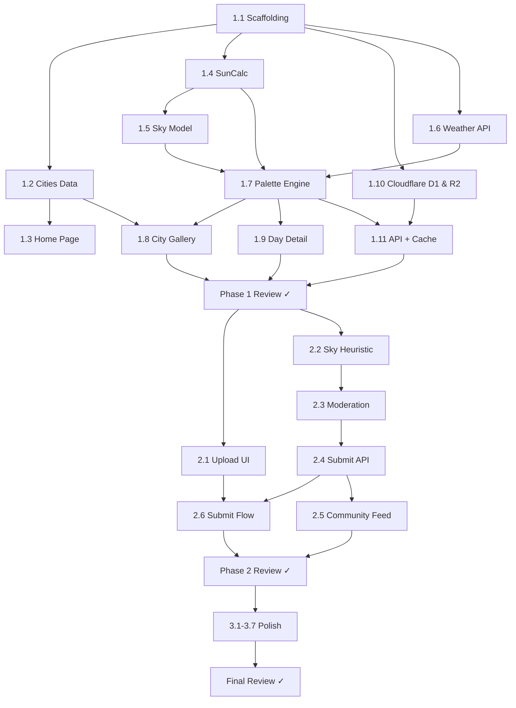

# Sky Palette — Implementation Task Breakdown

> **Status:** Ready to execute after design review  
> **Agents:** DeepSeek v4.1 (OpenCode) · Gemini 3.8 Flash · Coordinator (Claude Opus)

---

## Agent Assignment Strategy

| Agent | Strengths | Assigned Work |
|---|---|---|
| **DeepSeek v4.1** (OpenCode CLI) | Systems logic, algorithms, API integration, database | Sky model, palette math, API routes, DB schema, moderation, weather integration |
| **Gemini 3.8 Flash** | UI/UX, React components, animations, styling | All frontend components, animations, responsive design, page layouts |
| **Coordinator** (Claude Opus) | Architecture, integration, review | Code review, conflict resolution, integration testing, final assembly |

---

## Phase 1 — Core MVP

> **Goal:** Search a city → see generated palettes → drag the time slider.

### Task 1.1 — Project Scaffolding
| | |
|---|---|
| **Agent** | Coordinator |
| **Description** | Initialize Next.js 15 (App Router) + Tailwind CSS + TypeScript + Cloudflare Workers / Wrangler environment. Configure ESLint, Prettier, path aliases. Add initial dependencies: `suncalc`, `fuse.js`, `three`, `@cloudflare/workers-types`. Set up project structure per spec §13. |
| **Acceptance** | `npm run dev` starts clean. `npm run build` succeeds with zero errors. Folder structure matches spec. |
| **Dependencies** | None (first task) |

### Task 1.2 — Cities Dataset
| | |
|---|---|
| **Agent** | DeepSeek v4.1 |
| **Description** | Download GeoNames cities15000 dataset. Process into a compact JSON (~44k cities): `{ name, country, countryCode, lat, lon, timezone, population, slug }`. Generate URL-safe slugs. Write to `public/cities.json`. Create `lib/cities.ts` with Fuse.js search (fuzzy, weighted by population). |
| **Acceptance** | Search "buenos" returns Buenos Aires first. Search "tok" returns Tokyo. File size < 1.5MB gzipped. |
| **Dependencies** | 1.1 |

### Task 1.3 — Home Page + Bucharest Live Sky + City Search
| | |
|---|---|
| **Agent** | Gemini 3.8 Flash |
| **Description** | Build home page (`app/page.tsx`). Real-time physical sky simulation for Bucharest HQ (`44.4268° N, 26.1025° E`). Clean unobstructed top of screen (no logo or brand text). Understated Bucharest HQ time (`● Bucharest HQ · 15:17 EET`) sitting directly above the search bar as the single non-redundant location anchor. Borderless black floating search pill with concise placeholder (`placeholder="Search city or postal code"`), supporting cities and postal codes with city-first title hierarchy (e.g. `Bucharest`, `Tokyo`, `Paris`), twin-pill geometry when 1 result matches (`rounded-full`, same 52px/56px height, same size), multi-result rounded popovers, circular badges, and `Select →` affordance. Unified 52px/56px heights for Search bar, Bottom nav dock, and Circular share button. Jog-dial step scrubber with generous clearance (`mb-36 sm:mb-36 md:mb-40`, establishing a guaranteed 72px–76px clear gap above the bottom dock on desktop and mobile), 15-minute discrete stepping, circled capsule pill geometry (`border-radius: 9999px`), smooth background contrast adaptation (black on day, white on night), emerald live dot, iOS momentum and elastic bounce. Clean unobstructed bottom with zero redundant text. |
| **Acceptance** | Home sky accurately matches Bucharest daylight hours. Search bar, bottom dock, and share button share identical 52px height (56px desktop). When 1 result matches, dropdown mirrors search input as a fully rounded 52px/56px pill. City search always displays city as primary title. Scrubber exhibits fluid iOS momentum and bounce, stops at Bucharest live time, adapts text/active pill contrast smoothly between white and black based on sky luminance, and displays emerald green live dot. Bottom of the screen remains clean, uncluttered, and non-redundant. |
| **Dependencies** | 1.1, 1.2, 1.4 |

### Task 1.4 — SunCalc Integration (Bucharest HQ Anchor)
| | |
|---|---|
| **Agent** | DeepSeek v4.1 |
| **Description** | Create `lib/sun.ts` wrapper around SunCalc with Bucharest default anchor (`44.4268° N, 26.1025° E`). Functions: `getSunPosition(lat, lon, date, time)` → `{ elevation, azimuth }`. `getSunTimes(lat, lon, date)` → `{ sunrise, sunset, goldenHour, goldenHourEnd, dawn, dusk }`. All times formatted in city's local timezone. |
| **Acceptance** | Bucharest Nov 14 sunrise ≈ 07:12, sunset ≈ 16:51 (EET). Sun elevation at noon ≈ 28.4°, at 14:54 ≈ +21.4°. Tokyo, Reykjavik, Paris, and Buenos Aires tests pass. Unit tests pass. |
| **Dependencies** | 1.1 |

### Task 1.5 — Sky Model (Hosek-Wilkie Color Engine)
| | |
|---|---|
| **Agent** | DeepSeek v4.1 |
| **Description** | Create `lib/sky-model.ts`. Implement a simplified Hosek-Wilkie / Preetham sky color computation in TypeScript (no WebGL dependency for core math). Inputs: sun elevation, sun azimuth, turbidity, cloud layers (low/mid/high). Outputs: RGB colors for zenith, mid-sky, horizon, sun glow, cloud tint. Support OKLCH interpolation for smooth blending. Must run in < 1ms per palette computation. |
| **Acceptance** | Golden hour produces warm oranges/pinks. Noon produces deep blue zenith. Night produces near-black. High low-clouds produce gray. High high-clouds at sunset produce pink. Unit tests with reference color values. |
| **Dependencies** | 1.1, 1.4 |

### Task 1.6 — Open-Meteo Integration
| | |
|---|---|
| **Agent** | DeepSeek v4.1 |
| **Description** | Create `lib/weather.ts`. Fetch from Open-Meteo historical weather API: cloud cover (low/mid/high), visibility, temperature. Support date ranges. Implement caching layer (in-memory LRU + Cloudflare D1 persistence). Rate limit client to 1 req/sec. |
| **Acceptance** | Fetches Buenos Aires Nov 12 cloud data. Returns typed `WeatherData`. Caches second call. Handles API errors gracefully. |
| **Dependencies** | 1.1 |

### Task 1.7 — Palette Sampling
| | |
|---|---|
| **Agent** | DeepSeek v4.1 |
| **Description** | Create `lib/palette.ts`. Combines sky model + weather data → 5-swatch palette. Functions: `generatePalette(city, date, time)` → `Palette`. `interpolatePalette(p1, p2, t)` for smooth slider transitions. Export palette as hex codes + CSS gradient string. |
| **Acceptance** | Generates valid hex colors for any city/date/time combo. Interpolation is perceptually smooth (OKLCH). Performance: 1000 palettes/sec. |
| **Dependencies** | 1.4, 1.5, 1.6 |

### Task 1.8 — City Gallery Page + Search Location Modal
| | |
|---|---|
| **Agent** | Gemini 3.8 Flash |
| **Description** | Build `/city/[slug]/page.tsx` and `components/SearchLocationModal.tsx`. ISR with 1hr revalidation. Top bar with back button, city name, share icon. Responsive grid of square `DayCard` components. Each card shows date + 5-swatch vertical strip. Hover animation (scale + glow). Community badge on cards with submissions. Light-variant Search Location modal with white search bar (`bg-white text-black`, `placeholder="Search city or postal code"`), black query text, twin-pill 1-result matching pill geometry (`rounded-full h-[52px]`), circular emerald badges, and Popular Skies quick picks. |
| **Acceptance** | Grid renders 30 cards on load. Cards are square and responsive (2 cols mobile, 5 cols desktop). Hover animation is smooth. Search Location modal opens smoothly, matches light-variant theme with white search bar and black text, and filters cities/postal codes with city-first title hierarchy and single-result pill geometry. |
| **Dependencies** | 1.1, 1.2, 1.7 |

### Task 1.9 — Day Detail + Jog-Dial Time Scrubber
| | |
|---|---|
| **Agent** | Gemini 3.8 Flash + DeepSeek v4.1 |
| **Description** | Build `/city/[slug]/[date]/page.tsx` and shared `components/JogDialScrubber.tsx`. **Gemini:** Layout, swatch display, jog-dial scrubber UI with discrete 15-minute intervals, circled pill geometry (`border-radius: 9999px`), smooth atmospheric contrast adaptation (black on day, white on night), emerald live indicator dot, edge fade mask, responsive design, and dynamic time text sizing. **DeepSeek:** Wire scrubber to Preetham sky model, implement iOS momentum coasting ($0.93$ friction decay) and elastic rubber-band bounce return at bounds via `requestAnimationFrame`, ensuring 60-120fps direct canvas manipulation without React re-render lag. |
| **Acceptance** | Scrubber updates gradient + swatches at 60fps. No network calls during drag. Circled pills exhibit smooth rounded ends. Time text and active pill adapt smoothly to background luminance without abrupt switching. Hard stop with bounce at live time. |
| **Dependencies** | 1.4, 1.5, 1.7 |

### Task 1.10 — Cloudflare D1 & R2 Setup
| | |
|---|---|
| **Agent** | DeepSeek v4.1 / Coordinator |
| **Description** | Cloudflare D1 database and R2 storage configuration. Apply schema `schema.sql` to D1 database `sky-palette-db` (UUID `5e1c6b54-4020-4e9b-a5d5-0cea27498741` in `EEUR`). Configure R2 bucket `sky-photos` for zero-egress photo hosting. Create `wrangler.jsonc` with database and bucket bindings, mapping to custom domain `skypalette.app`. |
| **Acceptance** | D1 tables (`cities`, `submissions`, `daily_palettes`) and indexes verified live via Cloudflare API. R2 bucket bound. Zero cost, zero inactivity pauses. |
| **Dependencies** | 1.1 |

### Task 1.11 — API Routes + Caching
| | |
|---|---|
| **Agent** | DeepSeek v4.1 |
| **Description** | Build `api/palette/route.ts`: generates palette for city+date+time, caches in DB, returns with cache headers. Implement batch pre-generation for golden-hour palettes. Edge runtime for low latency. |
| **Acceptance** | First call generates + caches. Second call returns cached in < 50ms. Proper `Cache-Control` headers. Edge function cold start < 200ms. |
| **Dependencies** | 1.7, 1.10 |

### 🔍 Review Gate: Phase 1
| | |
|---|---|
| **Reviewer** | Coordinator + User |
| **Criteria** | Core flow works end-to-end. Performance targets met (LCP < 1.2s, slider 60fps). Design matches approved prototype. |

---

## Phase 2 — Community & Social

### Task 2.1 — Photo Upload Component
| | |
|---|---|
| **Agent** | Gemini 3.8 Flash |
| **Description** | Build `PhotoUpload.tsx`. Drag-and-drop zone + file picker + mobile camera button. Preview uploaded image. Extract EXIF (timestamp + GPS) via `exifr`. Show extracted metadata. Max 10MB, image types only. |
| **Acceptance** | Drag-and-drop works on desktop. Camera opens on mobile. EXIF timestamp + GPS extracted and displayed. Rejects non-image files. |
| **Dependencies** | Phase 1 complete |

### Task 2.2 — Client-Side Sky Heuristic
| | |
|---|---|
| **Agent** | DeepSeek v4.1 |
| **Description** | Create `lib/moderation.ts`. Canvas-based color analysis: compute HSL histogram, check sky-likeness (≥40% blue/orange/pink hues, <30% green). Extract 5-swatch palette from photo (sample top, upper-mid, mid, lower-mid, bottom regions). Return confidence score. |
| **Acceptance** | Correctly accepts sky photos. Rejects indoor/food/selfie images. False positive rate < 10%. Runs in < 200ms on mobile. |
| **Dependencies** | Phase 1 complete |

### Task 2.3 — Server-Side Moderation Cloudflare Worker
| | |
|---|---|
| **Agent** | DeepSeek v4.1 |
| **Description** | Cloudflare Worker `/api/moderate`. Receives photo. Resizes (1200px max + 300px thumbnail). Calls Cloudflare Workers AI (`@cf/microsoft/resnet-50`) NSFW classifier. Runs sky histogram check. If passes: write submission to Cloudflare D1 + upload photo and thumbnail to Cloudflare R2 (`sky-photos`). If fails: return rejection reason. |
| **Acceptance** | NSFW images rejected. Non-sky images rejected. Approved images appear in D1 within 5 seconds. Thumbnails generated correctly. |
| **Dependencies** | 2.2 |

### Task 2.4 — Submission API Route
| | |
|---|---|
| **Agent** | DeepSeek v4.1 |
| **Description** | Build `api/submit/route.ts`. Handles photo upload, calls moderation function, generates anonymous handle, rate-limits by IP hash (5/hr). Returns status + anonymous handle. |
| **Acceptance** | Upload + moderation completes in < 3 seconds. Rate limiting works. IP is hashed, not stored raw. |
| **Dependencies** | 2.3 |

### Task 2.5 — Community Feed Component
| | |
|---|---|
| **Agent** | Gemini 3.8 Flash |
| **Description** | Build `CommunityFeed.tsx` for day detail page. Shows approved submissions as thumbnail cards positioned along the timeline at their capture time. Tapping shows full photo + extracted palette side-by-side with generated palette. Query submissions via D1 edge cache with revalidation. |
| **Acceptance** | Submissions appear at correct timeline positions. New submissions render from D1 queries. Photo overlay shows both palettes. |
| **Dependencies** | 2.4 |

### Task 2.6 — Submit Flow Integration
| | |
|---|---|
| **Agent** | Gemini 3.8 Flash |
| **Description** | Wire PhotoUpload + sky heuristic + submit API into a smooth modal flow (`SubmitModal.tsx`). Single-line metadata layout for Location and Capture Time with integrated leading icons (MapPin, Clock) and no field labels. Quick circled color previews left of hex code text, plus overlapping 5-circle palette strip. Show upload progress, validation feedback, success/rejection state, and anonymous handle with regen button. Zero tracking, zero accounts. |
| **Acceptance** | End-to-end flow works: upload → validate → submit → see in feed. Rejections show helpful messages. No PII collected. Single-line metadata layout with leading icons and circled previews matches prototype. |
| **Dependencies** | 2.1, 2.2, 2.4, 2.5 |

### 🔍 Review Gate: Phase 2
| | |
|---|---|
| **Reviewer** | Coordinator + User |
| **Criteria** | Upload flow is intuitive. Moderation catches inappropriate content. Realtime feed works. Privacy requirements met. |

---

## Phase 3 — Polish & Share

### Task 3.1 — View Transitions
| | |
|---|---|
| **Agent** | Gemini 3.8 Flash |
| **Description** | Implement View Transitions API for navigation: Home → City Gallery (zoom-in), Gallery → Day Detail (card expand), all with graceful fallbacks. Use Framer Motion for orchestration. |
| **Acceptance** | Transitions feel native and smooth. No layout shift during transitions. Works without View Transitions API (graceful fallback). |

### Task 3.2 — Dynamic OG Images
| | |
|---|---|
| **Agent** | DeepSeek v4.1 |
| **Description** | Build `api/og/route.tsx` using `@vercel/og`. Generates PNG for `/city/[slug]/[date]`: city name, date, 5-swatch gradient bar, hex codes, "skypalette.app" watermark. Cached on CDN. |
| **Acceptance** | Sharing a day URL on Twitter/Discord shows beautiful card. Image renders in < 500ms. |

### Task 3.3 — Shareable Palette Card
| | |
|---|---|
| **Agent** | Gemini 3.8 Flash |
| **Description** | Build `ShareCard.tsx`. Downloadable as PNG (Canvas API) and SVG. Copy link button. Native share (Web Share API). Beautiful card design matching OG image. |
| **Acceptance** | Download as PNG works. Copy link works. Web Share opens native share sheet on mobile. |

### Task 3.4 — Responsive Polish
| | |
|---|---|
| **Agent** | Gemini 3.8 Flash |
| **Description** | Full responsive audit. Mobile-first refinement. Touch interactions on slider. Swipe gestures for gallery. Adaptive grid columns. |
| **Acceptance** | Lighthouse accessibility score ≥ 95. Works on iPhone SE through 4K desktop. |

### Task 3.5 — Performance Audit
| | |
|---|---|
| **Agent** | DeepSeek v4.1 |
| **Description** | Bundle analysis, code splitting, lazy loading. Three.js tree-shaking. Image optimization audit. Database query optimization. Lighthouse 100 target. |
| **Acceptance** | Lighthouse Performance ≥ 95. First load JS < 150KB gzipped. LCP < 1.2s. |

### Task 3.6 — Cloudflare Setup & Privacy-First Telemetry
| | |
|---|---|
| **Agent** | DeepSeek v4.1 |
| **Description** | Cloudflare proxy configuration: WAF rules, rate limiting rules, caching rules per spec §7.3. Integrate Cloudflare Web Analytics beacon (`beacon.min.js`) and `window.skyTelemetry` event bridge for privacy-first, zero-cookie, zero-fingerprinting Real User Monitoring (RUM) and Core Web Vitals (LCP, INP, CLS) telemetry without user consent banners. |
| **Acceptance** | Rate limiting works as specified. Cache hit ratio > 80% for palette/image requests. Telemetry runs cookie-free and GDPR/ePrivacy compliant with zero PII. |

### Task 3.7 — Discreet Project Info Modal, GitHub & Legal Disclosures
| | |
|---|---|
| **Agent** | Gemini 3.8 Flash |
| **Description** | Build discreet top info triggers (`w-9 h-9` top-right button on Home, top-bar icon on Gallery, header icon on Day Detail — sheet is actionable strictly via these top buttons, with footer anchor removed) and `#info-modal` containing: project description, GitHub repository link, GitHub Issues pre-filled bug reporting link with authentic Lucide bug icon, core technology cards (Hosek-Wilkie, SunCalc, Open-Meteo, Cloudflare D1 & R2 cookie-free storage, Cloudflare analytics), release notes changelog (v1.2.0, v1.1.0, v1.0.0), licenses (MIT, CC0 1.0 Universal, CC BY 4.0), and inline expandable drawers for Privacy Policy and Terms of Service. |
| **Acceptance** | Modal opens smoothly from top buttons with clean backdrop blur, ESC key support, external links opening in new tabs, collapsible legal drawers, authentic Lucide bug icons, and zero cookies. |

### 🔍 Final Review Gate
| | |
|---|---|
| **Reviewer** | Coordinator + User |
| **Criteria** | All features working. Performance targets met. Security audit passed. Ready for deployment. |

---

## Execution Order (Dependency Graph)

---

## Parallel Execution Windows

Tasks that can run simultaneously on different agents:

| Window | DeepSeek v4.1 | Gemini 3.8 Flash |
|---|---|---|
| **1** | 1.2 Cities + 1.4 SunCalc + 1.6 Weather | 1.3 Home Page (after 1.2) |
| **2** | 1.5 Sky Model + 1.10 Cloudflare D1 & R2 | — (waiting for sky model) |
| **3** | 1.7 Palette Engine + 1.11 API Routes | 1.8 City Gallery + 1.9 Day Detail (UI shell) |
| **4** | 2.2 Heuristic + 2.3 Moderation + 2.4 Submit | 2.1 Upload UI |
| **5** | 3.2 OG Images + 3.5 Perf + 3.6 Cloudflare | 3.1 Transitions + 3.3 Share + 3.4 Responsive + 3.7 About |
